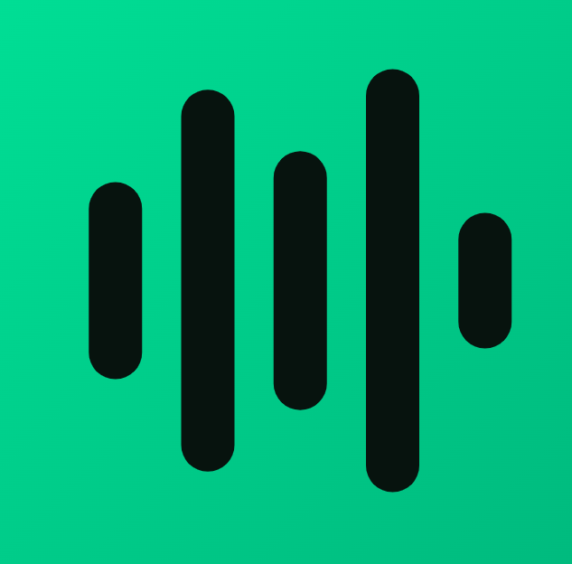

<div align="center">



# 🎵 SpoPlayer

**El reproductor de música de escritorio definitivo: letras sincronizadas estilo karaoke, visualizadores reactivos dinámicos, ecualizador gráfico y máxima personalización.**

[](https://github.com/FrancisQ221/SpoPlayer/releases/latest)
[](https://github.com/FrancisQ221/SpoPlayer/releases/latest)
[](https://electronjs.org)
[](https://react.dev)
[](https://www.typescriptlang.org)
[](https://tailwindcss.com)
[](./LICENSE)

<br/>

[Descargar Instalador (.exe)](#-descarga) •
[Características](#-características-principales) •
[Atajos de Teclado](#-atajos-de-teclado) •
[Desarrollo](#-desarrollo-y-construcción) •
[Créditos](#-créditos)

</div>

---

## 📥 Descarga

Puedes descargar el instalador oficial para Windows directamente desde la sección de lanzamientos:

👉 **[Descargar SpoPlayer para Windows (.exe)](https://github.com/FrancisQ221/SpoPlayer/releases/latest)**

*Compatible con Windows 10 y Windows 11 (64-bit).*

---

## ✨ Características Principales

### 🎤 Modo Zen con Karaoke Reactivo
* **Visualizador Inmersivo de Audio:** 4 modos de visualización reactiva a la música en tiempo real (*Espectro, Ondas, Aura Orbital y Polvo Estelar*).
* **Colorimetría Dinámica:** Los efectos, luces y degradados adoptan en tiempo real los colores y tonalidades de la portada del álbum que estás escuchando.
* **Karaoke Palabra por Palabra:** Letras sincronizadas con efecto de llenado progresivo en tiempo real al ritmo de la voz del artista.

### 🎚️ Ecualizador Gráfico de 5 Bandas (EQ)
* Ajusta los tonos a tu gusto con 5 bandas de precisión: **60 Hz (Sub/Graves), 230 Hz (Cuerpo), 910 Hz (Medios), 3.6 kHz (Presencia) y 14 kHz (Brillo/Agudos)**.
* **Presets Integrados:** *Plano, Refuerzo de graves (Bass Boost), Refuerzo de agudos, Vocales, Rock, Pop, Electrónica, Acústico y Personalizado*.
* Acceso instantáneo desde el MiniPlayer o presionando la tecla **`E`**.

### 🖥️ Integración con Bandeja del Sistema (System Tray)
* **Reproducción en Segundo Plano:** Al cerrar la ventana con la `X`, SpoPlayer se oculta en la barra de tareas de Windows para que la música nunca se corte mientras trabajas o juegas.
* **Menú Contextual Rápido:** Información del tema actual, controles de reproducción (*Play/Pause, Siguiente, Anterior*) y activación del Widget Flotante.

### 🏝️ MiniPlayer Flotante (Widget Overlay)
* Píldora de diseño flotante tipo *Dynamic Island* con efecto glassmorphism.
* Mantén el control de tus canciones mientras estás en pantalla completa en otras aplicaciones o navegando.

### 📻 Scrobbling Automático con Last.fm
* Conexión con tu perfil de **Last.fm**.
* Envío de estado *"Now Playing"* en tiempo real.
* Scrobble automático al alcanzar el umbral que elijas (50%, 75% o 90% de la pista).

### 🎮 Discord Rich Presence (RPC)
* Muestra en tu estado de Discord qué canción estás disfrutando, artista, portada en alta resolución, tiempo transcurrido y botón interactivo.

### ⏱️ Temporizador de Apagado (Sleep Timer)
* Programa el apagado de la música (15m, 30m, 45m, 1h o al final de la pista) con un suave desvanecimiento de volumen (*fade-out*).

### 📊 Cápsula Musical
* Consulta tus métricas personales de escucha, minutos acumulados y canciones favoritas.

---

## ⌨️ Atajos de Teclado

SpoPlayer incluye controles globales y rápidos pensados para no interrumpir tu flujo de trabajo:

| Tecla | Acción |
| :---: | :--- |
| **`Espacio`** | Reproducir / Pausar |
| **`Ctrl` + `→`** | Siguiente canción |
| **`Ctrl` + `←`** | Canción anterior |
| **`→` / `←`** | Avanzar / Retroceder 5 segundos |
| **`↑` / `↓`** | Subir / Bajar volumen (5%) |
| **`M`** | Silenciar / Restaurar volumen (Mute) |
| **`Ctrl` + `K`** o **`/`** | Abrir barra de búsqueda rápida |
| **`V`** | Alternar **Modo Zen** (Visualizador reactivo a pantalla completa) |
| **`E`** | Abrir / Cerrar el **Ecualizador de 5 bandas** |
| **`S`** | Abrir la **Cápsula Musical** (Estadísticas) |
| **`T`** | Abrir el **Temporizador de Apagado** |
| **`C`** | Alternar entre **Modo Cinemático** y Estándar en letras |
| **`F`** | Modo Pantalla Completa |
| **`Q`** | Abrir / Cerrar la Cola de Reproducción |
| **`L`** | Abrir / Cerrar el Panel de Letras |
| **`Alt` + `Shift` + `O`** | Mostrar / Ocultar el MiniPlayer flotante desde cualquier app |

*Todos los atajos son 100% personalizables desde **Ajustes > Atajos de teclado**.*

---

## 🛠️ Desarrollo y Construcción

Si deseas compilar o desarrollar localmente:

### Requisitos
* [Node.js](https://nodejs.org) (v20 o superior)
* [pnpm](https://pnpm.io) (`npm i -g pnpm`)

### Instalación

```bash
# 1. Clonar el repositorio
git clone https://github.com/FrancisQ221/SpoPlayer.git
cd SpoPlayer

# 2. Instalar dependencias
pnpm install
```

### Ejecutar en Desarrollo

```bash
# Inicia la aplicación en modo desarrollo con Hot-Reload (Vite + Electron)
pnpm run dev
```

### Compilar el Instalador (.exe)

```bash
# Genera el instalador de Windows (NSIS) en la carpeta release/
pnpm run electron:build:win
```

---

## 🎨 Arquitectura del Proyecto

```
SpoPlayer/
├── electron/
│   ├── main.ts              # Proceso principal de Electron, ventanas e IPC
│   ├── tray.ts              # Administrador de la bandeja del sistema (System Tray)
│   ├── preload.ts           # Context bridge seguro para el renderer
│   └── discord.ts           # Cliente de Discord Rich Presence
├── src/
│   ├── app/                 # Raíz de la aplicación y enrutador
│   ├── features/
│   │   ├── player/          # Motor de audio, Ecualizador 5-bandas, Modo Zen y MiniPlayer
│   │   ├── lyrics/          # Letras sincronizadas, modo cinemático y karaoke
│   │   ├── scrobbler/       # Integración Last.fm y generador MD5
│   │   ├── stats/           # Cápsula musical y estadísticas
│   │   ├── shortcuts/       # Gestor y grabador de atajos de teclado
│   │   └── settings/        # Panel de ajustes y personalización
│   └── shared/              # Componentes de interfaz, hooks y almacenamiento
├── package.json
└── vite.config.ts
```

---

## 👥 El Equipo / Contribuyentes

Este proyecto fue construido a puro código, café y madrugadas por un equipo de élite:

* 👑 **[FrancisQ221](https://github.com/FrancisQ221) (Pablo Cuches):** Creador, dirección del proyecto, arquitectura y diseño de producto.
* 🤖 **Antigravity (Google DeepMind):** Co-piloto de ingeniería de software, implementación de features y depuración.
* 🍕 **El pana del apoyo emocional:** Por mantener la moral alta, la fe intacta y acompañar en los momentos más tensos de la compilación.

---

## 💖 Tecnologías y Librerías

* Desarrollado y personalizado sobre la base del ecosistema libre de audio web y Electron.
* Componentes de sincronización de letras impulsados por `@braccato`.
* Shaders WebGL de fondo dinámico basados en `@kawarp`.
* Iconografía moderna de [Solar Icons](https://solar-icons.com) y [MingCute Icons](https://www.mingcute.com).

---

<div align="center">
  <sub>Hecho con ❤️ para los amantes de la música.</sub>
</div>
